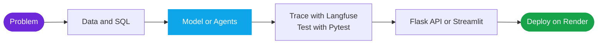

### I build AI systems that move from research notebooks to real products.

<!-- TODO: add these once you have the URLs, then delete this comment

-->

 

---

## 👋 About

AI Engineer at **Kombee Technologies** and B.Tech Computer Science student, building end-to-end AI solutions: data → training/agents → deployment (Flask, APIs). I'm most interested in **agentic AI**, **healthcare AI**, **smart detection systems** and **recommendation engines**.

- 🧠 **Focus:** agentic AI (Google ADK, CrewAI, LangGraph), computer vision, deep learning, LLM applications
- 🔍 **Observability:** tracing and evaluating LLM apps with Langfuse
- 📄 **Research:** published *Crop Selection using Machine Learning Techniques* (IET, 2025), reporting 99.5% accuracy
- 🌱 **Learning now:** MLOps (DVC, MLflow, CI/CD), multi-agent systems, system design

---

## 📖 My Journey

  

---

## 🧭 How I Build

---

## 🤝 Let's Collaborate

I'm happy to talk about, or work on:

- 🤖 **Agentic AI apps:** multi-agent workflows with LangGraph, CrewAI, Google ADK and MCP
- 🩺 **Computer vision and ML for healthcare and agriculture**
- 🔍 **LLM observability and evaluation** with Langfuse
- ⚙️ **MLOps:** data versioning (DVC), experiment tracking (MLflow) and CI with GitHub Actions

---

## 🛠️ Tech Stack

<h4 align="center">🧠 Machine Learning & Computer Vision</h4>

  
  
  
  
  
  
  
  
  

<h4 align="center">🤖 GenAI & Agentic AI</h4>

  
  
  
  
  
  
  
  
  
  

<h4 align="center">⚙️ MLOps & DevOps</h4>

  
  
  
  
  
  
  
  

<h4 align="center">🗄️ Data, SQL & BI</h4>

  
  
  
  
  

<h4 align="center">🌐 Backend, Web & Mobile</h4>

  
  
  
  
  
  
  

---

## 🚀 Featured Projects

<table>
  <tr>
    <td width="33%" valign="top" align="left">
      <h3>🗺️ TravelAI</h3>
      
<b>Multi-agent travel planner</b>

      
LangGraph + MCP agents solve itinerary constraints (weather, budget) with a human-approval step.

      
  

      
<a href="https://github.com/Pragyan2004/TravelAI-Advanced-Multi-Agent-Travel-Constraint-Solver">💻 Code</a>

    </td>
    <td width="33%" valign="top" align="left">
      <h3>🗣️ LIPI AI</h3>
      
<b>Indian-language correction engine</b>

      
Neural syntax and spelling correction for 22 Indian languages.

      
  

      
<a href="https://github.com/Pragyan2004/LIPI_AI">💻 Code</a> &nbsp;·&nbsp; <a href="https://lipi-ai.onrender.com/">🚀 Live demo</a>

    </td>
    <td width="33%" valign="top" align="left">
      <h3>🥗 NutriNavigator</h3>
      
<b>AI nutrition &amp; fitness planner</b>

      
Personalised diet and workout plans from a 9-parameter form, powered by Llama 3 70B on Groq.

      
  

      
<a href="https://github.com/Pragyan2004/NutriNavigator">💻 Code</a> &nbsp;·&nbsp; <a href="https://nutrinavigator-s0yc.onrender.com">🚀 Live demo</a>

    </td>
  </tr>
</table>

<table>
  <tr>
    <td width="33%" valign="top" align="left">
      <h3>📊 Market Research Crew</h3>
      
<b>Agentic research reports</b>

      
CrewAI + Gemini agents turn a product idea into a market research report.

      
  

      
<a href="https://github.com/Pragyan2004/Automated-Market-Research-Crew">💻 Code</a>

    </td>
    <td width="33%" valign="top" align="left">
      <h3>🐾 WildlifeID</h3>
      
<b>Footprint-based species ID</b>

      
Computer-vision platform that identifies animal species from footprint patterns.

      
  

      
<a href="https://github.com/Pragyan2004/WildlifeID">💻 Code</a>

    </td>
    <td width="33%" valign="top" align="left">
      <h3>🚗 Smart Parking Detection</h3>
      
<b>Real-time space detection</b>

      
VGG16 CNN served through Flask to detect free parking spaces.

      
  

      
<a href="https://github.com/Pragyan2004/Parking-Space-Detection-with-AI-and-Flask">💻 Code</a>

    </td>
  </tr>
</table>

---

## 📄 Research

**Crop Selection using Machine Learning Techniques**, IET, 2025. Predicts suitable crops from climate and soil factors, reporting **99.5% accuracy**.
<!-- TODO: add the paper link or DOI here, e.g. [Read the paper](https://doi.org/...) -->

---

## 💼 Experience

| Company | Role | Duration |
|---|---|---|
| **Kombee Technologies** | AI Engineer | Mar 2026 – Present |
| **Arth Technologies and Consultancy** | Data Analysis | Jan 2026 – Mar 2026 |
| **InLightx Global** | AI/ML Intern | Sep 2025 – Feb 2026 |
| **Feynn Labs** | ML & Data Science Intern | Mar 2025 – May 2025 |
| **CodeAlpha** | ML Intern | Dec 2024 – Mar 2025 |
| **LearnTricks** | Data Analyst Intern | Nov 2024 – Dec 2024 |

---

## 📊 GitHub Activity

<picture>
  <source media="(prefers-color-scheme: dark)" srcset="https://raw.githubusercontent.com/Pragyan2004/Pragyan2004/output/github-contribution-grid-snake-dark.svg">
  <source media="(prefers-color-scheme: light)" srcset="https://raw.githubusercontent.com/Pragyan2004/Pragyan2004/output/github-contribution-grid-snake.svg">
  
</picture>

---

